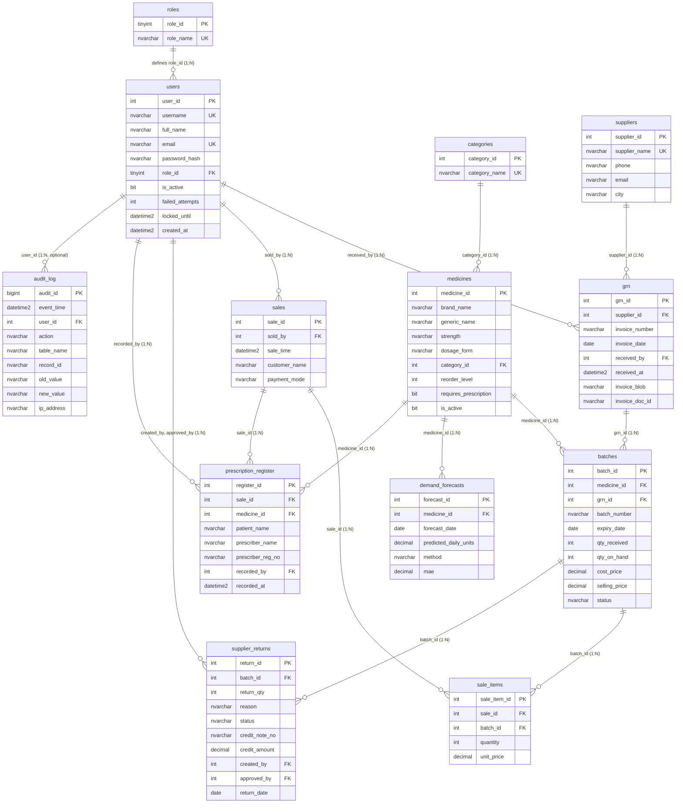

# ExpiryGuard Rx: Entity Relationship (ER) Diagram

This document models the 13 relational tables and their cardinalities for ExpiryGuard Rx in Mermaid syntax and text representation, directly derived from `sql/01_schema.sql`.

---

## Cardinality & Relationship Summary

- **roles (1) &rarr; users (N)**: Each user belongs to exactly one role; each role classifies multiple users.
- **categories (1) &rarr; medicines (N)**: Medicines belong to one therapeutic category.
- **suppliers (1) &rarr; grn (N)**: A wholesaler supplies multiple delivery invoices over time.
- **grn (1) &rarr; batches (N)**: A single goods received note can contain multiple batch lots.
- **medicines (1) &rarr; batches (N)**: A medicine has multiple received lots with differing expiry dates and acquisition costs.
- **sales (1) &rarr; sale_items (N) &larr; batches (1)**: Resolves the many-to-many relationship between customer bills and inventory batches. `sale_items` records the historical `unit_price` at transaction time.
- **batches (1) &rarr; supplier_returns (N)**: Returns link directly to physical batch lots without replicating supplier identity (reached via `batches -> grn -> suppliers`).
- **sales (1) &rarr; prescription_register (N) &larr; medicines (1)**: Prescriptions record patient and doctor credentials for statutory Schedule H/X dispensing.
- **users (1) &rarr; audit_log (N, nullable)**: Captures who performed state mutations. System actions or anonymous failures record `NULL` for `user_id`.
